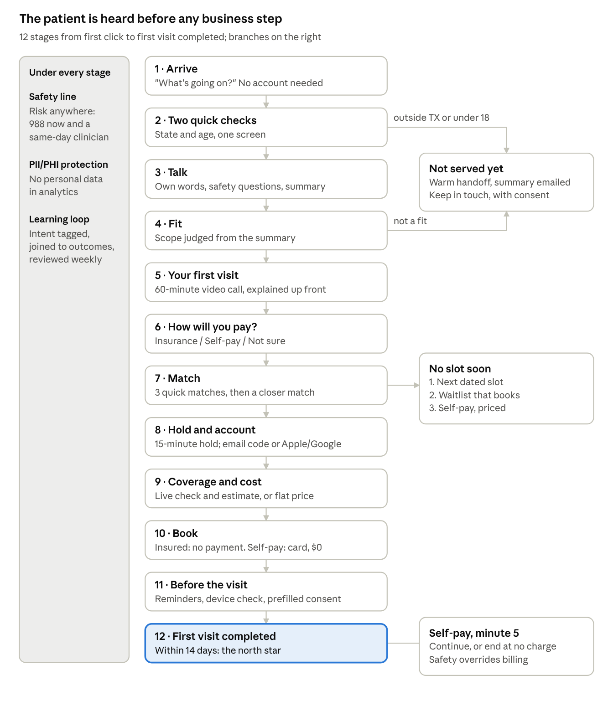

# PRD: Patient-First Onboarding (v1)

Nov 5, 2026 · @Jay Madduru

Rebuild Legion's onboarding so a Texas adult is heard first and handled second: the patient's need comes before insurance, payment and scheduling, safety runs through every step, and success is a completed first visit within 14 days of starting.

## Problem

Today's onboarding asks about insurance, payment, identity and scheduling before it asks about the patient. Changing individual screens won't fix that; the order is the problem.

| Evidence | Source |
| --- | --- |
| The care flow first asks why the patient is here on screen 10 of 17. 12 of its 17 screens serve business needs, 3 serve safety, 2 serve the patient. | [Funnel Map v2](../01-current-state/funnel-map-v2.md) |
| The measured portal flow keeps 23.8% of sessions to the payment page. Two steps, fit check to conditions (34.8% lost) and match to provider selected (36.6% lost), account for 67% of the 4,495 lost sessions. | PostHog, 5,898 sessions over 30 days, in the brief |
| A typed "suicidal thoughts" after a "No" on the safety question drew no follow-up. | [Observations v2](../01-current-state/observations-v2.md), O-11 |
| Insured patients found every clinician fully booked; self-pay had slots the next day. | Observations v2, O-22 |
| Payment shows $250 with no breakdown or charge date. Jay stopped there: "I don't know what I'm paying for, when I'm gonna be paid." | Observations v2, O-16 |
| PostHog stops at the payment page and counts sessions, not people. Nothing after payment is tracked, so the brief's end point, a completed first visit, is invisible. | The brief |

The full friction list (FP-01 to FP-13) and hypotheses (H-00 to H-13) are in [Friction Hypotheses and Experiments v2](../02-hypotheses/hypotheses-experiments-v2.md).

## Goals and success metrics

**North star: first visit completed within 14 days of starting, per qualified person** ([D-06](../decision-log.md)). A qualified person is an adult in Texas whose need Legion treats. Counted per person, not per session.

Goals:

1. Ask about the patient's need before any business step, and keep every patient safe at every step ([D-10](../decision-log.md), D-07).
2. Get more qualified people to a completed first visit than today's flow does, measured in a 50/50 test (H-00).
3. Make every step explain itself: why this match, what it costs, when the card is charged, what the visit is.
4. Learn from every conversation, so the next round of changes comes from what patients told us, not guesses.

| Stage metric | Definition | Baseline today |
| --- | --- | --- |
| Start to conversation done | Arrived and confirmed their summary | Not measured; portal fit check to conditions loses 34.8% |
| Conversation to match shown | Summary confirmed and in scope | Not measured |
| Match to slot held | Picked a clinician and a time | Portal match to provider selected loses 36.6% |
| Personalize uptake | Share who answer the closer-match questions | New |
| Slot held to booked | Account made, coverage checked, booking confirmed | Not measured past the payment page |
| Booked to visit completed | Showed up and finished visit 1 | Not measured |
| Self-pay continue rate | Self-pay patients who continue past minute 5 | New |
| Kept for later | People Legion can't serve yet who consent to be contacted | New |

Guardrails, checked on every test: crisis-routing rate (must not fall), time from a safety flag to clinician contact, visit-1 no-show rate, refunds and chargebacks, switch requests after visit 1, complaints.

## Users and scope

Primary user: an adult in Texas looking for psychiatric care for themselves, often unsure what kind of help they need ([D-02](../decision-log.md)). Two money paths run through the same flow: insured and self-pay.

Secondary users:

- **People Legion can't serve yet** (another state, under 18, or a need outside Legion's care): handed off warmly and, with consent, kept for later.
- **Returning patients:** confirm what's on file instead of starting over.
- **Clinicians:** read the patient's own words and summary before visit 1; fill in a capability profile that feeds matching (F-30, simulated in the prototype).
- **Legion's clinical and operations teams:** review safety flags, sign off wording, run the weekly learning review.

| In scope | Out of scope for v1 |
| --- | --- |
| First click to first visit completed, care flow replacement ([D-05](../decision-log.md)) | Care after visit 1 (follow-ups, prescriptions, refills) |
| Insured and self-pay paths | Serving minors (backlog; the keep-in-touch list becomes its launch audience) |
| Conversational intake, safety layer, matching, account, coverage, booking, visit prep | Other states |
| Provider capability profile (simulated) | Real insurer eligibility and payment integrations in the prototype |
| Events through visit completed | Clinician-side scheduling and credentialing tools |

## The to-be funnel

The patient's need comes first (stages 1 to 5); money, account and scheduling follow (6 to 10); getting to the visit is part of onboarding (11 and 12).

Nobody hits a dead end: people Legion can't serve are handed off and kept for later, and no open slot leads to a dated slot, a waitlist or a priced self-pay option, in that order.

## Requirements by stage

Each stage has requirements (R-xx) a build must meet. Every stage also carries the three layers in the next section.

### 1. Arrive

- R-01. The entry asks "What's going on?" with a text box and a few plain starters. No account, no sign-up. (H-01, F-01)
- R-02. The marketing carousel shows each clinician's next open date, never "no availability". (FP-01)

### 2. Two quick checks

- R-03. Ask state and age before the conversation, in one screen, with a line on why.
- R-04. Outside Texas or under 18: warm handoff (R-12) and keep-in-touch capture (R-13). Under 18 captures a parent or guardian's email only.

### 3. Talk

- R-05. Before anything is stored, a plain consent: what we keep, who reads it, that it's AI and a clinician reads everything before the visit.
- R-06. The patient types or speaks in their own words. The assistant asks 3 to 5 follow-ups: what's going on, how long, what's been tried, medications, diagnosed or new (asked once). (H-06, H-08, F-03, F-04)
- R-07. Right after the first answer, the assistant asks the standard safety questions in plain words. They can't be skipped. (H-07, D-07)
- R-08. The risk screen reads every word typed or spoken, at every stage. A risk shows 988 call and text at once and starts same-day clinician contact. (F-14)
- R-09. The assistant shows a plain summary with suggested clinical terms. The patient confirms or edits it. The confirmed summary is the one intake record; nothing in it is asked again. (H-08)

### 4. Fit

- R-10. Scope is judged from the confirmed summary.
- R-11. In scope continues. Out of scope goes to R-12 and R-13.
- R-12. Warm handoff: says plainly why, gives 2 to 3 specific next places (988, FindTreatment.gov, the insurer's behavioral health line), offers to email the summary.
- R-13. Keep in touch: name, email or phone, state, reason not served, the summary if they agree. One explicit consent box, separate from terms; text messages need their own opt-in; every message has an opt-out. When Legion can serve them, one message brings them back to where they stopped. (F-32)

### 5. Your first visit

- R-14. Before matching, show what visit 1 is: 60-minute video call, who it's with (a psychiatric clinician), what to have ready. (H-13, F-18, F-19)

### 6. How will you pay?

- R-15. One question, no data entry: Insurance, Self-pay, Not sure. It filters the match to bookable slots. "Not sure" shows both, each with its price labelled.

### 7. Match

- R-16. Show 3 quick matches at once, each with one reason line built from the patient's own signals: what it fits, plan, next opening. "See everyone" below. (H-09, F-06)
- R-17. Under the matches, offer "Want a closer match?": about two minutes of skippable questions (clinician gender, language, style, identity-affirming care, visit times). Answers re-rank the three and show "Matched on: ...", editable. Identity preferences are stored as preferences about the clinician, not facts about the patient. (F-29)
- R-18. No slot soon, in this order: next dated slot, then a waitlist that books the first opening and texts them, then self-pay with its price. Self-pay is never shown first or pushed. (H-10, F-07, F-23, F-24)

### 8. Hold and account

- R-19. Picking a slot holds it for 15 minutes and asks where to send the confirmation: email and a code, or Apple or Google sign-in. (H-02, F-02)
- R-20. A known email shows "Welcome back, here's what we have" to confirm or edit. (H-03, F-05)
- R-21. The session's conversation and preferences attach to the account here and become permanent.

### 9. Coverage and cost

- R-22. Insured: card photo (fields read automatically) or member ID, a live coverage check in seconds, and "Your first visit will cost about $X" with one line on why. (H-04, F-10)
- R-23. If the check can't finish, booking still goes ahead: "We'll confirm your coverage within 1 business day and text you before anything is charged."
- R-24. Not covered: switch plan or move to self-pay on the same screen, no phone call. (H-11, F-13)
- R-25. Self-pay: the flat price and the free-5-minutes rule, stated plainly.

### 10. Book

- R-26. One summary card: who, when, 60-minute video call, cost, when the card is charged, cancellation rule. (H-12, F-11)
- R-27. Insured: no payment step. Legion bills the insurer.
- R-28. Self-pay: card saved at booking, nothing charged. "We won't charge anything unless you choose to continue past 5 minutes." Apple Pay and Google Pay first. (F-12, F-33)
- R-29. Address autocomplete; no default birth date. (H-05, F-17)

### 11. Before the visit

- R-30. Email and text confirmation with a calendar invite; reminders 24 hours and 1 hour before.
- R-31. One-tap camera and microphone check; a "what to have ready" list.
- R-32. Records consent and required forms, prefilled from the intake record.
- R-33. Self-serve reschedule. A missed visit gets a rebooking offer the same day.

### 12. First visit

- R-34. Self-pay: at minute 5 the clinician checks in and the app shows "Continue the visit" with the price. Declining ends the visit at no charge.
- R-35. A safety risk in the free minutes means care continues, whatever the payment choice.
- R-36. Visit completed fires the north-star event.

## Cross-cutting layers

Three layers run under every stage. A stage isn't done until all three are in place for it.

### Safety at every step

- L-01. Every response carries the safety line that fits that moment, in plain human words. Examples: Talk, "If you're not safe right now, call or text 988. You don't have to finish this first." Match with no slot this week, "If things get worse before your visit, call or text 988 any time." Pay, "If cost is what's stopping you, 988 is free and open now." Before the visit, "If you feel worse before Tuesday, reply here or call 988. Don't wait for the appointment."
- L-02. The risk screen (R-08) runs on all free text and speech, including the day-before check-in and messages to the care team.
- L-03. Safety ships to everyone; only wording and placement are tested (D-07). Clinical review signs off every safety line (F-26).

### PII and PHI protection (F-31)

- L-04. Analytics events and logs never carry personal or health details. Names, contact details, birth dates, member IDs, addresses and conversation text are removed or replaced with tokens before anything leaves the app.
- L-05. Sensitive fields are encrypted at rest. Access is by role, with a reason, and every access to a record is logged.
- L-06. Insurance card photos: fields read, image encrypted with a set retention period or deleted once verified.
- L-07. The conversation before an account exists is held for the session only, under the consent in R-05, and made permanent at account creation (R-21).
- L-08. Retention rules for keep-in-touch contacts and people who drop off: what is kept, for how long, and how to ask for deletion.

### Learning loop (F-28)

- L-09. Each confirmed conversation is tagged with intent (what brought them, diagnosed or new, urgency) and history (past care, medications, what they've tried).
- L-10. Tags are joined to outcomes: matched, booked, paid, showed up, dropped, and at which stage.
- L-11. A weekly review compares drop-off by intent, not just by screen. What it finds becomes the next round of hypotheses.
- L-12. Analysis runs on de-identified conversations only. A clinician sees the full record, only for care.

## Experiments

The whole funnel is tested first against today's flow, 50/50 per person, with the north star as the primary metric (H-00). If it wins, it becomes the new control, and the tests below find which parts carry the lift. Every test assigns a person, not a session (D-08), and uses the guardrails above.

| Test | Stage | Control | Variant | Primary metric |
| --- | --- | --- | --- | --- |
| Funnel test | All | Today's care flow | Patient-first funnel v1 | First visit completed within 14 days |
| T-01 | Arrive | "Book Appointment Now" | "What's going on?" | Visitors who finish the conversation |
| T-02 | Hold and account | Account first | Account at slot hold | Starts that reach a held slot |
| T-03 | Hold and account | Returning email to provider list | Confirm what's on file | Returning patients who book |
| T-04 | Coverage | Logo pick and a range | Live check and estimate | Insured starts that book |
| T-06 | Talk | Diagnostic chips | Conversation (and chips plus "help me describe it" if traffic allows) | Conversation completed |
| T-08 | Talk, Before the visit | Ask again | Prefill from the intake record | Returning sessions that book |
| T-09 | Match | Long list sorted by opening | 3 with reasons | Match to slot held |
| T-10 | Match | "Please call" | Dated slot, auto-booking waitlist, priced self-pay | No-slot sessions that book within 14 days |
| T-12 | Book (self-pay) | Price line, card form | Breakdown and charge date × one-tap wallets (2×2) | Self-pay booking confirmed |
| T-13 | Your first visit | Visit explained at booking | Visit explained before the match | Visit-1 show rate |
| T-14 (new) | Match | Closer-match panel below the matches | Placement and copy variants | Personalize uptake, then match to slot held |
| T-15 (new) | First visit (self-pay) | Price charged at booking | First 5 minutes free, charged only on continue | Self-pay visits completed; refunds and chargebacks as guardrails |

At about 197 sessions a day, run the funnel test first and only a few component tests at once, each on a different stage with its own assignment. T-14 and T-15 need sign-off before launch: T-15 spends clinician time on free minutes.

## Instrumentation

One event per stage, from first click to visit completed, tied to one person once an email is known (F-20, F-25). Events carry IDs and categories only, never personal or health details (L-04). Variant exposure is logged with every assignment.

| Event | Fires when | Key properties |
| --- | --- | --- |
| `onboarding_started` | First answer to "What's going on?" | entry point, variant |
| `eligibility_checked` | State and age submitted | result: in scope, out of state, under 18 |
| `conversation_consented` | R-05 consent given |  |
| `safety_screened` | Safety questions answered | outcome category only |
| `risk_flagged` | Risk screen or answer raises a flag | stage, source (question or free text) |
| `crisis_routed` | 988 shown or clinician contact started | stage |
| `summary_confirmed` | Patient confirms the summary | edited (yes or no), diagnosed or new, intent tags |
| `out_of_scope` | Fit judged not a fit | reason category |
| `kept_for_later` | Keep-in-touch consent given | reason category, channel |
| `pay_intent_chosen` | R-15 answered | insurance, self-pay, not sure |
| `matches_shown` | Quick matches shown | count with a slot this week |
| `personalize_started` / `personalize_completed` | Closer-match questions | questions answered count |
| `slot_held` | Patient picks a time | quick or personalized, days to slot |
| `waitlist_joined` | No-slot waitlist chosen |  |
| `account_created` / `returning_confirmed` | R-19, R-20 | method |
| `coverage_checked` | Live check returns | result: covered, not covered, pending |
| `booking_confirmed` | Summary confirmed | pay path |
| `visit_prep_done` | Device check passed |  |
| `visit_joined` | Patient joins the call |  |
| `self_pay_continued` | Minute-5 choice | continued or ended |
| `visit_completed` | Clinician marks visit 1 complete | days since `onboarding_started` |
| `visit_missed` / `visit_rebooked` | No-show and rebook |  |

## Dependencies, risks and open questions

| Risk | Mitigation |
| --- | --- |
| The assistant misreads a disclosure or suggests a wrong clinical term | Patient confirms every summary; risk screen runs independently of the assistant; clinician reads everything before visit 1; clinical review of prompts and wording (F-26) |
| Insured patients still see no slots because supply is short | The pay question shows only bookable slots; waitlist books the first opening; operations work on supply before T-10 |
| Free minutes cost clinician time and invite abuse | T-15 measures continue rate, refunds and chargebacks; one free start per person |
| Storing the conversation before an account breaks Legion's HIPAA setup | Session-only hold under explicit consent (L-07), pending Legion's confirmation |
| Conversation adds time and some people want a form | Measure time to summary; keep the chips-plus-help arm in T-06 if traffic allows |

Open questions for Legion:

- [ ] Can intake answers be held before an account exists under Legion's HIPAA setup?
- [ ] Do insured patients need a card on file for copays?
- [ ] Who signs off on the free 5 minutes for self-pay (operations and finance)?
- [ ] When is the self-pay card charged, and what is the cancellation rule? The prototype uses placeholders: charged after the visit, free to cancel up to 24 hours before.
- [ ] Is no availability for insured patients a supply problem or a display problem?
- [ ] Which conditions and levels of care are outside Legion's scope, for the fit check?
- [ ] Who on the clinical team reviews safety lines and assistant wording, and how fast?

Related: [Decision Log](../decision-log.md) · [Feature Backlog](../feature-backlog.md) · [Friction Hypotheses and Experiments v2](../02-hypotheses/hypotheses-experiments-v2.md)
