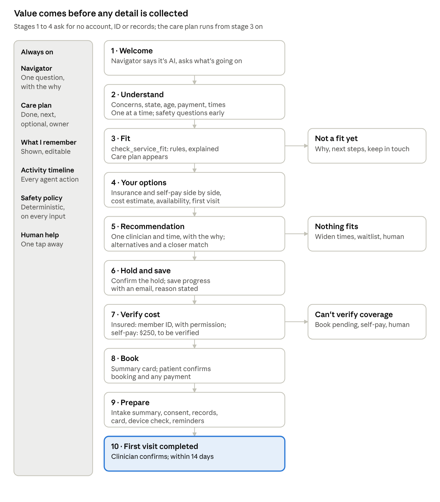

# PRD: Empathetic, Agentic Onboarding (v2)

Nov 5, 2026 · @Jay Madduru

The product is empathetic at every step and agentic in the background: a navigator understands the patient first, then does the work for them with tools, with their permission, and shows every action it takes. Success is a completed first visit within 14 days of starting. Replaces [PRD v1](prd-v1.md).

## Principle and approach

**Leadership principle:** make the product empathetic at every step, and agentic with hooks and tools that fetch data and run checks in the background.

We use a hybrid agentic workflow. Five parts, each with one job:

| Part | Job |
| --- | --- |
| Conversational navigator | Understands the patient and explains every decision |
| Structured cards and forms | Collect information the patient has confirmed |
| Visible care plan | Shows what's done, what's next, what's optional, and who owns each step |
| Tool-backed actions | Do specific tasks: check fit, estimate cost, find and hold appointments, prepare forms |
| Deterministic policies | Decide the sensitive things: service fit, safety routing, when confirmation is required |

Two weaker approaches we are not taking:

- **Chat only:** flexible, but hard to trust, evaluate and finish reliably.
- **A traditional form with an AI sidebar:** safer, but the AI is decoration, not an agent.

### Agent operating loop

Every navigator turn follows the same contract:

1. **Observe:** what does the patient need, and what is already known?
2. **Plan:** what is the safest useful next action?
3. **Explain:** why is that action recommended?
4. **Confirm:** does it need the patient's permission? If so, ask.
5. **Act:** call one bounded tool.
6. **Report:** show the result, its source, and whether it is verified, estimated, simulated or unknown.
7. **Continue or escalate:** update the care plan, or bring in a human.

## Problem

Today's onboarding lacks basic empathy: it asks for insurance, payment, identity and scheduling before it asks about the patient. The care flow first asks why you're here on screen 10 of 17, and 12 of its 17 screens serve business needs. The measured portal flow keeps 23.8% of sessions to the payment page; two steps, describing care needs and picking a clinician, cause 67% of the losses. A typed suicide disclosure after a "No" got no follow-up. Nothing after the payment page is tracked, so the brief's end point, a completed first visit, is invisible.

Evidence: [Funnel Map v2](../01-current-state/funnel-map-v2.md) · [Observations v2](../01-current-state/observations-v2.md) · [Friction Hypotheses and Experiments v2](../02-hypotheses/hypotheses-experiments-v2.md).

## Patient-empathy goals

Ten goals. Each has the behavior we expect and the signal that tells us whether it's working.

| Goal | Expected behavior | How we know |
| --- | --- | --- |
| G1. Understand before asking | Learn the patient's goal, concerns, location, payment preference and scheduling constraints before any long workflow. Ask one useful question at a time and say why it matters. | Questions per screen = 1; every question has a "why" line; share who reach fit without abandoning |
| G2. Establish fit early and compassionately | Decide basic service fit with transparent, deterministic rules. Explain what Legion can help with, state its limits, and give a respectful next step when Legion isn't right. | Fit decided before any account or identifier; off-ramp shows a reason and a next step 100% of the time |
| G3. Deliver value before collecting details | Show likely fit, payment options, estimated cost, availability and the onboarding plan before asking for an account, detailed history, insurance IDs or records. | Value screens reached before the first identifier request; drop at the first identifier request |
| G4. Build and keep a personalized plan | A visible care plan built from the patient's situation and updated as things change: done, next, optional, and who owns each step. | Plan shown from fit onward; plan updates after every tool result |
| G5. Act for the patient, with permission | Do the work: check simulated coverage, find appointments, compare providers, prepare forms, save progress, draft the intake summary. Ask before anything consequential. | Tool actions per completed onboarding; zero consequential actions without a confirmation event |
| G6. Explain every recommendation | Recommend one clear next action, say why, and let the patient review alternatives. | Every recommendation has a reason and an "other options" path; alternative views per recommendation |
| G7. Remember without being invasive | Reuse what the patient already said, show what's remembered, let them correct it, and don't collect what isn't needed yet. | Repeated questions = 0; memory edits per session; fields collected before they're needed = 0 |
| G8. Recognize uncertainty and recover | Notice missing, conflicting, unavailable or out-of-authority information. Ask a focused question, offer an alternative, keep progress, or bring in a human. Never invent coverage, prices, availability or clinical answers. | Recovery paths taken vs dead ends (target: no dead ends); human handoffs; zero unlabelled estimates |
| G9. Keep clinical authority and safety boundaries clear | AI organizes, explains, summarizes and coordinates. It does not diagnose, assess crisis risk on its own, prescribe or decide treatment. Safety routing uses deterministic rules; clinicians review summaries and make clinical decisions. | Safety routing fired by policy, not by the model; refusals on diagnosis and medication questions; clinician sign-off on every summary |
| G10. Continue until the first visit is done | Stay useful after booking: consent, records, insurance card, preparation, reminders, joining the visit, and confirming the first visit happened. | First visit completed within 14 days; pre-visit tasks done before the visit; no-show rate |

## Must-haves

These hold on every screen and in every variant.

- **M-01. Label AI.** AI-generated text and AI actions are marked as AI, every time.
- **M-02. Confirm before consequential actions.** Booking, payment, consent, records access and sending any information each need an explicit yes from the patient.
- **M-03. Label every fact.** Each figure or result shows whether it is verified, an estimate, simulated, or unknown.
- **M-04. Treat insurance and self-pay as equals.** Both shown side by side, in the same plain terms, neither as the default.
- **M-05. Self-pay price.** $250 per visit, the current assumption, shown with a "to be verified" mark until Legion confirms.
- **M-06. No dark patterns.** No fake urgency, no hidden costs, no forced account creation.
- **M-07. A human is always one tap away,** and every off-ramp is respectful and leads somewhere.
- **M-08. Activity timeline.** Every agent action appears in a simple timeline the patient can open.
- **M-09. Synthetic only in the prototype.** Synthetic patients, simulated integrations; no real health, identity, insurance or payment data entered.
- **M-10. Access.** Works on phones, with a keyboard, readable labels, clear focus states and plain language.
- **M-11. Log decisions and events, never sensitive content.**

## The to-be funnel

Ten stages. The first four deliver value and ask for nothing that identifies the patient; details come only once the patient has a reason to give them.

Every recovery path keeps the patient's progress and offers a human. None of them ends the conversation.

## Requirements by stage

Tools are named as in the [Prototype Spec v2](prototype-spec-v2.md). "Confirm" means the patient says yes before the action runs (M-02).

### 1. Welcome

- R-01. The navigator says it's an AI assistant, that a clinician makes every clinical decision, and that a human is one tap away. Then: "What's going on? Tell me in your own words." (G1, M-01)
- R-02. No account, sign-up or contact details asked for. (M-06)

### 2. Understand

- R-03. One question at a time, each with a short "why we ask" line from `explain_question`. Order: concern in their own words, state, age, payment preference (insurance, self-pay, not sure), when they can meet. (G1)
- R-04. The standard safety questions come right after the first open answer. The safety policy evaluates every answer and every free-text line from here on. (G9)
- R-05. A "What I remember" card fills as they answer: plain facts, each editable. Nothing is asked twice. (G7)

### 3. Fit

- R-06. `check_service_fit` applies published rules (Texas, 18+, concerns Legion treats, not an emergency) and shows which rule decided and why. (G2)
- R-07. Not a fit: say plainly why, give 2 to 3 specific next places, offer to email their own words back to them, offer keep-in-touch with separate consent, offer a human. (G2, M-07)
- R-08. A fit: the care plan appears, built from what they said. Each step shows status, whether it's optional, and who owns it (you, Legion, your clinician, your insurer). (G4)

### 4. Your options

- R-09. `get_payment_options` shows insurance and self-pay side by side in the same terms (M-04). Self-pay: $250 per visit, marked "to be verified" (M-05). Insurance: accepted plans and a typical cost range, marked "estimate". (G3, M-03)
- R-10. `search_provider_availability` shows how soon visits are available for their payment path and times, without asking for anything new. (G3)
- R-11. Explain the first visit: 60-minute video call with a psychiatric clinician, what to have ready. (G3)

### 5. Recommendation

- R-12. `recommend_provider` gives one clinician and one time, with the reasons (their concerns, plan, times) and two alternatives one tap away. (G6)
- R-13. "Want a closer match?" offers about two minutes of skippable preference questions (clinician gender, language, style, identity-affirming care). Answers re-rank and show "Matched on: ...". (G6, G7)
- R-14. Time doesn't fit: the navigator asks one focused question ("What times work better?") and searches again. Nothing available: widen the window, offer a waitlist that holds the first opening, offer the other payment path neutrally, offer a human. No dead end. (G8)

### 6. Hold and save

- R-15. `hold_appointment` runs only after the patient confirms. The hold is real system behavior, shown calmly with no countdown pressure. (M-02, M-06)
- R-16. `save_patient_progress` asks for an email with the reason ("so you can come back to this and we can send your confirmation"), confirmed before anything is sent. Leaving at any point keeps progress for the session. (G5, G7)

### 7. Verify cost

- R-17. Insured: with permission, the patient enters a member ID or card photo; `estimate_patient_cost` returns a result labelled verified, estimated or unknown, with its basis. (G5, G8, M-03)
- R-18. Coverage can't be verified: say so, never guess; offer to book with verification pending ("We'll confirm before anything is charged"), the self-pay option, or a human. (G8)
- R-19. Self-pay: $250, marked to be verified, with when it's charged and the cancellation rule. (M-05)

### 8. Book

- R-20. One summary card: who, when, format, cost and its label, when charged, cancellation rule. The patient confirms the booking, and separately confirms any payment. (M-02)
- R-21. Insured: no card needed unless Legion confirms one is required for copays. Self-pay: card or wallet, confirmed.

### 9. Prepare

- R-22. `prepare_intake_summary` drafts a summary in the patient's own words, marked AI-generated and "not a diagnosis". The patient reviews it and confirms before it's shared with the clinician. (G9, M-01, M-02)
- R-23. `check_previsit_requirements` lists consent, records authorization, insurance card, device check, with owners. Consent and records access each need their own confirmation. (G10, M-02)
- R-24. Reminders 24 hours and 1 hour before, with the safety line; reschedule without a call.

### 10. First visit completed

- R-25. Help joining the call at the time. `mark_first_visit_complete` fires only on the clinician's confirmation. A missed visit gets a same-day rebooking offer. (G10)

## Safety and clinical boundaries

The model never makes a safety or clinical decision. Rules do, and clinicians do.

| The AI may | The AI may not |
| --- | --- |
| Organize what the patient said, explain options, summarize in their words, coordinate tasks | Diagnose, name a condition the patient has, or suggest one |
| Explain what a first visit covers and who decides treatment | Recommend, compare or comment on medications or doses |
| Pass every input to the safety policy and show its result | Decide on its own whether someone is at risk |
| Say "I don't know" and bring in a human | Invent coverage, prices, availability or clinical answers |

**Deterministic safety policy (P-SAFE).** Runs on every answer and every line of free text, at every stage, separately from the model. A match on its reviewed rules (an answer on the safety questions, or a phrase in free text) routes at once: 988 call and text shown at the top, same-day clinician contact started, the patient free to keep going. The policy, not the model, fires the route. Rules and wording are owned and reviewed by Legion's clinical team.

**Deterministic fit policy (P-FIT).** Published rules for state, age, concerns Legion treats and emergencies, each shown to the patient when it decides.

**Confirmation policy (P-CONFIRM).** A fixed list of actions that always need the patient's yes: hold, book, pay, consent, records access, sending any information, sharing the intake summary.

**Refusals.** Asked "Do I have bipolar?" or "Should I take Lexapro?", the navigator says it can't answer that, explains that the clinician will at the visit, and offers to add the question to the intake summary so it gets answered.

**Safety at every step.** Each stage carries a short safety line that fits the moment, for example "If you're not safe right now, call or text 988. You don't have to finish this first." Clinical review signs off every line.

**Privacy.** Analytics and logs never carry names, contact details, birth dates, member IDs, addresses or conversation text (M-11). Sensitive fields are encrypted, access is by role and audited, and the learning loop works on de-identified conversations only.

## Metrics and experiments

**North star:** first visit completed within 14 days of starting, per qualified person ([D-06](../decision-log.md)).

| Stage metric | Definition | Goal it tracks |
| --- | --- | --- |
| Understood | Reached fit with all five basics answered | G1 |
| Value before details | Reached stage 4 without any identifier asked | G3 |
| Recommendation accepted | Held the recommended time, or an alternative they chose | G6 |
| Recovered | Hit a recovery path (no fit, nothing fits, can't verify) and still booked or chose keep-in-touch | G8 |
| Booked | Confirmed a booking | G5 |
| Prepared | All required pre-visit tasks done before the visit | G10 |
| Completed | First visit completed within 14 days | North star |
| Human handoffs | Share of sessions that asked for or were routed to a human, and why | G8 |

Guardrails on every test: safety routes fired by policy, time from a safety route to clinician contact, refusal accuracy on clinical questions, no-show rate, refunds and chargebacks, complaints.

**Tests.** The whole funnel first, against today's flow, 50/50 per person (H-00). Then the parts, a few at a time at about 197 sessions a day:

| Test | Question | Primary metric |
| --- | --- | --- |
| Funnel test | Does the empathetic, agentic funnel beat today's flow? | North star |
| T-06 | Navigator conversation vs today's diagnostic chips | Reached fit |
| T-09 | One recommendation with reasons vs a long list | Recommendation accepted |
| T-10 | Recovery paths vs "please call" | Recovered |
| T-12 | Self-pay: cost breakdown and wallets vs a plain card form | Booked (self-pay) |
| T-14 | Closer-match offer: placement and wording | Recommendation accepted |
| T-15 | Self-pay: first 5 minutes free, charged only on continue, vs $250 at booking. Needs operations and finance sign-off. | Completed (self-pay) |
| T-16 (new) | Care plan visible from fit vs shown only after booking | Prepared, then Completed |

## Instrumentation and the activity timeline

Two records, two audiences, the same rule: decisions and events, never sensitive content (M-11).

**Activity timeline (for the patient).** Every agent action appears as one plain line, with time, what was done, the result label, and whether the patient confirmed it. Example: "10:42 · Checked which clinicians take Lone Star Health PPO · Simulated · No confirmation needed." "10:44 · Held Tue 4 pm with Dr. Ruiz · You confirmed." (M-08)

**Event log (for Legion).** One event per stage step and per tool call, tied to one person once an email is known (F-20, F-25). Properties are IDs, categories and labels only.

| Event | Fires when | Properties |
| --- | --- | --- |
| `onboarding_started` | First answer to "What's going on?" | variant |
| `question_answered` | Each understand question | question id, explained (shown or opened) |
| `safety_policy_evaluated` | Every input | outcome category, rule id |
| `safety_route_fired` | P-SAFE routes | stage, rule id |
| `fit_decided` | `check_service_fit` returns | result, rule id |
| `kept_for_later` | Keep-in-touch consent | reason category, channel |
| `options_shown` | Stage 4 | payment paths shown, availability window |
| `tool_called` | Any tool | tool, result label (verified, estimated, simulated, unknown), failure code |
| `confirmation_requested` / `confirmation_given` / `confirmation_declined` | P-CONFIRM actions | action type |
| `recommendation_shown` / `alternative_chosen` | Stage 5 | reason codes, rank chosen |
| `memory_edited` | Patient corrects a remembered fact | field category |
| `recovery_path_taken` | Any recovery | path |
| `human_requested` | Human help | stage, reason category |
| `clinical_question_refused` | Diagnosis or medication question | category |
| `booking_confirmed` | Stage 8 | pay path |
| `previsit_task_done` | Each stage 9 task | task |
| `visit_completed` | Clinician confirms | days since start |

## Risks, open questions, and changes from v1

| Risk | Mitigation |
| --- | --- |
| A patient trusts an AI summary as a diagnosis | Marked AI-generated and "not a diagnosis"; written in the patient's words, no suggested conditions; clinician reviews before the visit |
| The safety phrase list misses a disclosure | Clinician-owned rules, reviewed on every flagged and unflagged sample in the learning review; standard questions always asked as well |
| One question at a time feels slow | Each question has a why line; measure time to fit; the patient can answer several things in their first message and the navigator skips what it already knows |
| Estimates read as promises | Every figure carries its label (M-03); nothing is charged on an estimate |
| Insured patients still find no slots | Availability shown at stage 4, before anything is asked; recovery paths at stage 5; supply is an operations question |

Open questions for Legion:

- [ ] Confirm the self-pay price ($250 per visit is our assumption) and when it is charged.
- [ ] Is a card needed on file for insured copays?
- [ ] Can the session be held before an account exists under Legion's HIPAA setup?
- [ ] Which concerns and levels of care are outside Legion's scope, for P-FIT?
- [ ] Who owns the P-SAFE rules and safety lines on the clinical team?
- [ ] Is no availability for insured patients a supply or a display problem?
- [ ] Sign-off for T-15 (free first 5 minutes).

**What changed from v1:**

- The leadership principle, the hybrid model and the operating loop now frame the whole product.
- Ten patient-empathy goals (G1 to G10) and eleven must-haves replace v1's four goals.
- Value (fit, options, cost estimate, availability, plan) now comes before any account or identifier; cost moved earlier as an estimate and is verified later.
- The conversation no longer suggests clinical terms. Summaries stay in the patient's words, and fit is decided by published rules, not by the model.
- New: the visible care plan, "What I remember", the activity timeline, labelled facts, and a confirmation policy.
- Self-pay is $250 per visit, marked to be verified. The free first 5 minutes moved from default to a test (T-15).
- The appointment hold no longer shows a countdown.
- 12 stages became 10.
