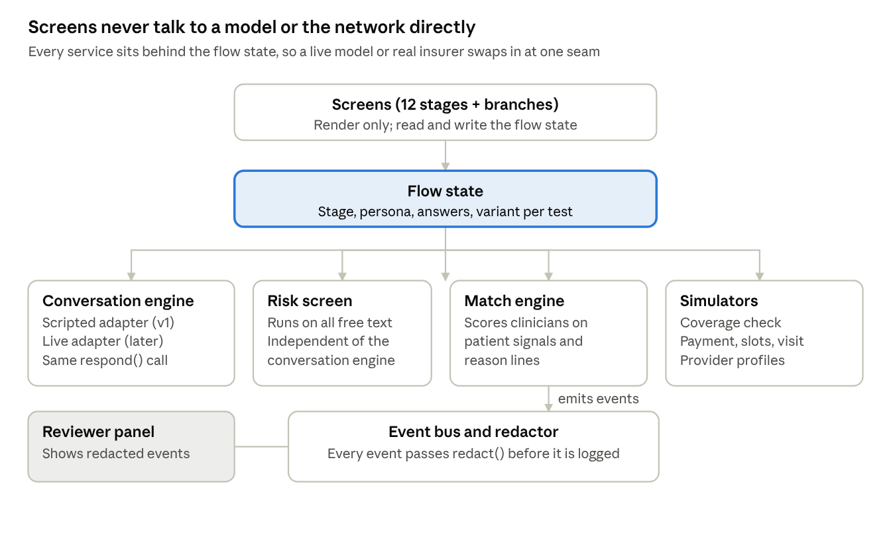

# Prototype Spec: Patient-First Onboarding (v1)

Nov 5, 2026 · @Jay Madduru

A clickable, deployed prototype of the to-be funnel in the [PRD](prd-v1.md): one self-contained page on GitHub Pages, reached through a pull request from a `prototype` branch. It shows every stage, the four paths below, and a reviewer panel that explains what happens behind each screen. Everything is simulated: no real patient data, insurers or payments.

## Constraints

| Area | Rule |
| --- | --- |
| Build | Vanilla JS and Tailwind. Source in small files under `prototype/src/`; a build script inlines them into one self-contained `prototype/index.html`. No framework, no backend. |
| Hosting | GitHub Pages from the repo. Linked from the submission page (`index.html`, step 4). |
| Delivery | Built on a `prototype` branch, opened as a pull request into `main` using the repo's PR template. |
| Data | Fictional personas and clinicians only. Everything stays in memory in the browser; nothing is stored or sent anywhere. No real insurer, eligibility or payment calls. |
| Safety | 988 links are real (`tel:988`, `sms:988`). Every screen carries its safety line (PRD L-01). The risk screen runs on every free-text field. |
| Conversation | Scripted and branching for v1, behind one interface so a live model can replace it later without touching the screens. |
| Design | Run ui-ux-pro-max's design-system search for a healthcare product first and follow its palette, type and UX rules. Phone first (most patients start on a phone), then desktop. |
| Accessibility | WCAG 2.1 AA contrast, full keyboard use, visible focus, screen-reader labels, dark mode, reduced motion respected, no emoji as icons, touch targets at least 44 px. |
| Copy | Every patient-facing line passes no-ai-slop. Safety and clinical lines are marked for clinical review. |

## Scenarios

A reviewer picks a scenario from a start menu, or just starts typing as themselves. Each scenario prefills a fictional persona so the path takes about two minutes. All names, plans and clinicians are made up.

| ID | Scenario | Persona | Path | Ends at |
| --- | --- | --- | --- | --- |
| S-1 | Insured, happy path | Maya, 29, Austin. Anxiety and poor sleep for months, never diagnosed. Fictional plan "Lone Star Health PPO". | All 12 stages; coverage check returns covered with a $30 estimate; asks for a closer match | First visit completed (simulated) |
| S-2 | Self-pay, free 5 minutes | Daniel, 41, Houston. Diagnosed with depression years ago, off medication, wants to restart. | Self-pay at stage 6; card saved at $0; minute-5 "Continue the visit" | First visit completed, charged after the call |
| S-3 | Safety disclosure | Priya, 24, Dallas. Answers No to the safety question, then types that she's been having thoughts of not wanting to be here. | Risk screen flags the free text; 988 call and text shown at once; same-day clinician contact starts; she can still continue | Crisis routing screen, then back to the flow |
| S-4 | Not served yet | Two cases: Sam, 34, in California; Alex, 16, in Texas. | Stage 2 handoff; keep-in-touch capture (a parent's email for Alex) | Kept for later |
| S-5 | No slot soon | Maya again, with a plan whose clinicians are full this week. | Match shows the fallback order: next dated slot, auto-booking waitlist, priced self-pay | Joined the waitlist, or booked the dated slot |
| S-6 | Provider profile | Dr. Elena Ruiz, a fictional psychiatric nurse practitioner. | Fills the capability profile (conditions and confidence, approach, languages, times); a clinical-lead calibration step; then re-runs S-1 to show her in Maya's matches with new reasons | Maya's match updated |
| S-7 | Returning patient | Maya, a month later, using the same email. | Stage 8 shows "Welcome back, here's what we have" to confirm | Booked without retelling her story |

## Screens

One screen per stage, plus the branches. Requirement IDs point to the PRD. Copy here is draft; it gets a no-ai-slop pass and clinical review before the PR.

| # | Screen | Shows | Key copy (draft) | PRD |
| --- | --- | --- | --- | --- |
| 1 | Arrive | One question, a text box, four starters ("I can't sleep", "I feel anxious a lot", "I want to restart medication", "I'm not sure") | "What's going on? Tell us in your own words." | R-01 |
| 2 | Two quick checks | State dropdown, birth date | "Two quick things so we don't waste your time: where you live and your date of birth." | R-03, R-04 |
| 3 | Talk | Chat with typed or spoken input; consent card first; safety check after the first answer; summary card with suggested terms to confirm or edit | "I'm an AI assistant. A clinician reads everything before your visit." · "Before we go on, I want to check how you're doing right now." | R-05 to R-09 |
| 3a | Crisis routing | 988 call and text buttons at the top; "A clinician will call you today"; option to keep going | "You don't have to finish this first." | R-08, L-01 |
| 4 | Fit | Usually invisible; shows only when out of scope | — | R-10, R-11 |
| 4a | Not served yet | Why, 2 to 3 next places, email my summary, keep-in-touch form with separate consent boxes | "Legion can't treat you in California yet. Here's where to get help now." | R-12, R-13 |
| 5 | Your first visit | 60-minute video call, who it's with, what to have ready | "Your first visit is a 60-minute video call with a psychiatric clinician." | R-14 |
| 6 | How will you pay? | Three large choices | "How do you plan to pay? This only helps us show times you can actually book." | R-15 |
| 7 | Match | 3 cards with reason lines and next opening; "See everyone"; "Want a closer match?" panel; fallback block when no slot | "Treats anxiety with sleep problems · Takes your plan · Next opening Tue 4 pm" | R-16 to R-18 |
| 7a | Closer match | 5 skippable questions in the chat; re-ranked cards with "Matched on: ..." chips | "A few quick things so I can find the right person. Skip any of them." | R-17 |
| 8 | Hold and account | 15-minute countdown; email and code, or Apple or Google (simulated); returning confirm screen | "We'll hold Tuesday 4 pm for you for 15 minutes. Where should we send your confirmation?" | R-19 to R-21 |
| 9 | Coverage and cost | Card photo or member ID; checking state; estimate; pending fallback; switch plan or self-pay | "Your first visit will cost about $30. That's your plan's specialist copay." | R-22 to R-25 |
| 10 | Book | Summary card; insured confirm with no payment; self-pay wallet and card form at $0 | "We won't charge anything unless you choose to continue past 5 minutes." | R-26 to R-29 |
| 11 | Before the visit | Confirmation, calendar invite, reminder preview, device check, what to have ready, prefilled consent, reschedule | "If you feel worse before Tuesday, reply here or call 988. Don't wait for the appointment." | R-30 to R-33 |
| 12 | First visit | Simulated call screen; self-pay minute-5 prompt; visit completed | "Want to continue the visit? It's $X, charged after the call. If not, you pay nothing." | R-34 to R-36 |
| P | Provider profile | Conditions with confidence, approach, languages, times; calibration by a clinical lead | "What do you treat best?" | F-30 |

## Architecture

Screens only render and update the flow state. Every service sits behind it, so the scripted conversation, simulated coverage and simulated payments can each be swapped for a real service without touching a screen.

| Module | File | Does | Tested by |
| --- | --- | --- | --- |
| Flow state | `src/flow.js` | Stage order, branches, persona, answers, variant per test; pure transition function | Unit: every scenario's stage sequence |
| Conversation engine | `src/conversation.js` | `respond(history, context)` returns `{reply, followUp, summaryDraft}`. v1 = scripted adapter: keyword-branching replies per persona and free text. A live adapter later implements the same call. | Unit: each persona's script reaches a summary |
| Risk screen | `src/risk.js` | `screen(text)` returns `{level, matched}` from a phrase list reviewed by clinicians. Runs on every free-text field, separately from the conversation engine. | Unit: catches S-3's phrasing, plain and misspelled; no flag on ordinary text |
| Match engine | `src/match.js` | Scores fictional clinicians on condition fit, plan, slot within urgency, and preferences; returns the top 3 with reason lines; applies the no-slot fallback order | Unit: S-1, S-5, S-6 rankings and reasons |
| Simulators | `src/sim.js` | Coverage check (covered, not covered, pending), slots, payment at $0, visit timer, provider profiles | Unit: each outcome reachable |
| Event bus and redactor | `src/events.js` | `emit(name, props)`; `redact(props)` drops or tokenizes names, contact, birth date, member ID, address and free text | Unit: no personal field survives redact() |
| Screens and reviewer panel | `src/ui/*.js` | Render each stage; panel reads state and the redacted event log | End-to-end: Playwright runs S-1 to S-7 |
| Build | `build.mjs` | Inlines CSS and JS into `prototype/index.html` | Smoke: built page loads with no console errors |

## Reviewer panel

A drawer the reviewer opens with a "How this works" button or the `R` key. It's closed by default, so the patient view is what you see first. It shows:

- **This stage:** name, number, the PRD requirements it meets, the hypotheses and tests it belongs to.
- **Variants:** for each test that touches this stage, which arm you're in and a switch to flip it. Flippable in v1: T-01 (entry), T-06 (conversation vs chips), T-09 (3 with reasons vs long list), T-10 (fallback vs "please call"), T-12 (breakdown and wallets), T-14 (closer-match panel placement), T-15 (free 5 minutes vs charge at booking). Flipping a variant re-renders the current screen.
- **Events:** the live event log, as stored after `redact()`, so reviewers can see that no name, birth date, member ID or conversation text gets through. A "Show raw" toggle shows the before and after side by side, clearly labelled "never stored".
- **Safety layer:** this stage's safety line, the risk screen's last result, and a button to inject the S-3 phrase and watch routing happen.
- **Learning loop:** the intent tags the conversation produced (e.g. "new, anxiety, sleep, 3+ months, not urgent") and the outcome they would join to.
- **Scenario controls:** restart, jump to any stage, switch persona.

## Testing and acceptance

Logic is built test-first: each module's unit tests are written and fail before the code exists. The PR opens only when everything below passes, with the output pasted into the PR description.

- [ ] Unit tests (`node --test`) pass for flow, conversation, risk, match, sim and events.
- [ ] `redact()` test: a fixture with every personal field comes out with none of them.
- [ ] Risk screen catches S-3's phrasing, with and without typos, and flags nothing in S-1's and S-2's conversations.
- [ ] Playwright runs S-1 to S-7 end to end on the built `index.html`, at phone (390 px) and desktop (1280 px) widths, with no console errors.
- [ ] Every screen shows its safety line, and 988 links use `tel:` and `sms:`.
- [ ] Automated accessibility check (axe) shows no serious or critical issues on any screen; keyboard-only run of S-1 completes.
- [ ] Dark mode and reduced motion checked on every screen.
- [ ] No patient-facing screen asks for insurance, payment or an account before stage 6, checked by a test on the stage order (D-10).
- [ ] All copy passed no-ai-slop; safety and clinical lines listed for clinical review.
- [ ] Deployed GitHub Pages URL loads, linked from the submission page and the PR.
- [ ] PR template checklist complete: first screen asks about the patient (D-10), safety the same in every variant (D-07), assignment per person (D-08), events through visit completed (F-20), no real patient data.

Out of scope for v1: a live AI model, real insurer and payment integrations, real video calls, storing anything between visits, and the clinician-side app beyond the profile screen.
